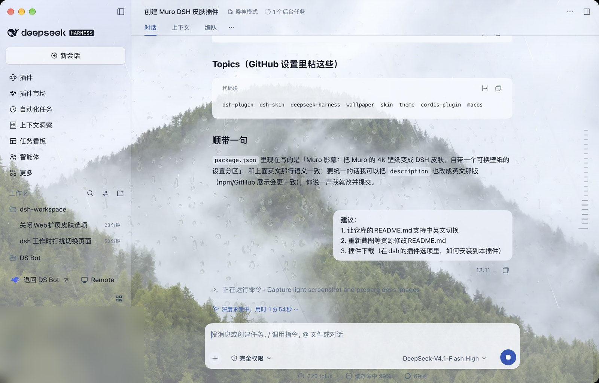
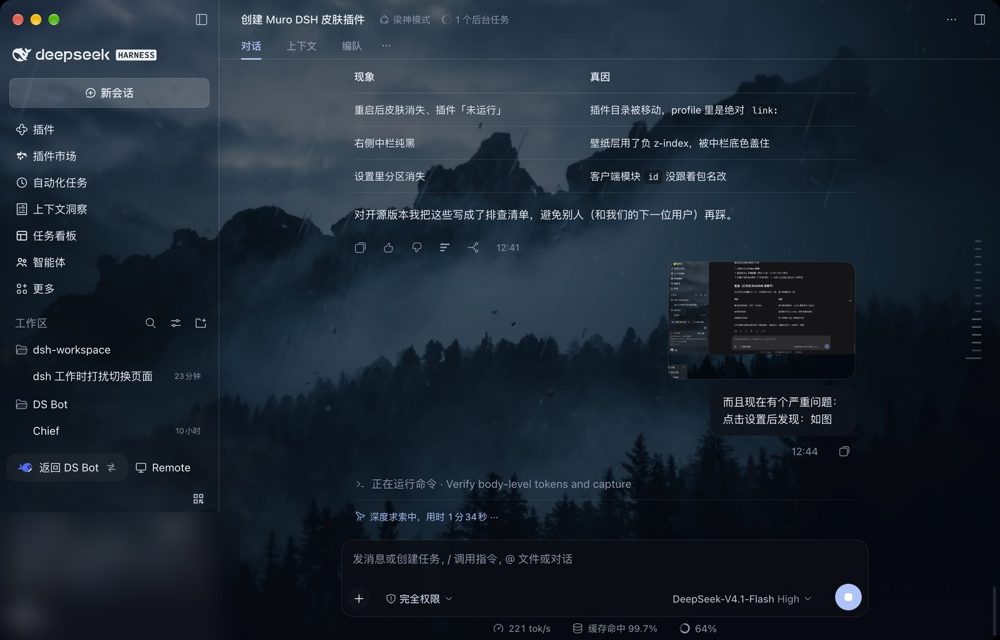

# Muro Glass · dsh-skin-muro

[中文](README.md) · **English**

Bring [Muro](https://github.com/MrRockySL/Muro) — a native macOS live-wallpaper app — into the
[DeepSeek Harness](https://github.com/deepseek-ai/deepseek-harness) web GUI: a full-bleed wallpaper underneath
liquid-glass panels, ice blue `#A9C4FF` as the only accent, and a whole settings section for the wallpaper library.

| Light | Dark |
| --- | --- |
|  |  |

## Features

- **Library** — the settings section loads Muro’s public catalog on open (551 wallpapers, 7 categories), with title search, category filter and an `All / Local` switch
- **Download** — one 下载资源 action per wallpaper, with real byte progress in the card; finished entries get a 本地 badge
- **Apply** — 设为暗色壁纸 / 设为亮色壁纸 on local cards: a local copy, then the skin repoints itself and repaints
- **Light/dark aware** — the wallpaper follows macOS appearance (or the DSH theme). A theme with no wallpaper of its own falls back to the other one instead of going blank
- **Dials** — dim, panel opacity, blur, brightness, saturation, contrast, grayscale, framing, plus presets; dim defaults to each frame’s mean luma, so dark art stays dark and bright art gets veiled
- **Download folder** — the panel shows where frames live, opens it in Finder, and can move it (existing frames travel along)
- **Self-hosted look** — the plugin paints its own stylesheet and wallpaper layer; it does not depend on the skin center

## Requirements

- macOS (frame extraction uses AVFoundation)
- DeepSeek Harness desktop (verified on 0.2.2-rc.3)
- `swift` (Xcode Command Line Tools is enough)

## Install

### 1. Command line (recommended, verified)

```sh
git clone <repo> dsh-skin-muro
cd ~/.dsh/profiles/desktop
pnpm add "link:/absolute/path/to/dsh-skin-muro"
```

Then add `"dsh-skin-muro"` to `dsh.profile.bundles` in `~/.dsh/profiles/desktop/package.json` and reload the page
(or restart DSH). **Settings → Muro 影幕** appears at the bottom of the settings sidebar.

### 2. DSH’s plugin panel

The plugin panel (sidebar → Plugins / Plugin Market) resolves npm specs. **This plugin is not published to npm**,
so it cannot be installed by package name. If your build accepts a local path, paste:

```
link:/absolute/path/to/dsh-skin-muro
```

Otherwise use option 1. Once installed, the **sidebar plugin page** can enable/disable it; the **plugin list in
Settings is read-only** (by design).

### 3. From npm (published — the easiest way)

`dsh-skin-muro@1.0.0` is on npm: install by package name from the plugin panel, or from the command line:

```sh
cd ~/.dsh/profiles/desktop
pnpm add dsh-skin-muro
```

Then add `"dsh-skin-muro"` to `dsh.profile.bundles`.

Releasing (maintainers):

```sh
npm version patch && git push --follow-tags   # the tag triggers GitHub Actions, published with provenance
```

### Skin only (no plugin)

```sh
cp -R skin ~/.dsh/skins/muro
```

> Note: in DSH 0.2.2-rc.3 the skin center does **not** apply user-directory skins (`~/.dsh/skins/*` is ignored;
> built-in skins work). That is why the plugin paints its own look.

## Usage

1. **Settings → Muro 影幕**; the catalog loads by itself
2. Click a card to select it; click 下载资源 to download that one (progress in the card)
3. On a local card, click 设为暗色壁纸 / 设为亮色壁纸 — it applies immediately
4. Not happy with the contrast? Drag 压暗 / 面板 or hit a preset; it is live, no reload

## Settings

| Control | Range | Default | Effect |
| --- | --- | --- | --- |
| Dim | 0–80% | auto | Veil between wallpaper and content — the main contrast lever |
| Panel | 0–85% | 45% | Panel opacity: higher hides the wallpaper and improves legibility |
| Blur | 0–24px | 0 | Softens wallpaper detail |
| Brightness / Sat / Contrast | 50–130% / 0–160% / 80–140% | 100 / 105 / 100 | The wallpaper itself |
| Grayscale | 0–100% | 0 | De-colour |
| Framing | center / top / bottom | center | Vertical crop position |

Dials live in `~/.dsh/muro-appearance.json`; the library path lives in `~/.dsh/muro-config.json`.

## How it works

```
page (src/client.js)                     host (src/index.js)
  │ GET  /muro/state                       → install state, both backdrops, local library, appearance
  │ GET  /muro/catalog?q=&category=&local= → Muro catalog (10 min cache)
  │ POST /muro/download {id}               → background job: fetch master (3 retries) → grab a frame → store
  │ GET  /muro/job?id=                     ←  { stage, received, total }
  │ POST /muro/apply {id, theme}           → copy to backdrop-<theme>-<stamp>.jpg and rewrite skin.json
  │ POST /muro/appearance / /muro/cache    → appearance toggle, dials, download folder
  └ injects <link href="/muro/skin.css?v=…"> and sets html[data-muro-skin]
```

Five decisions worth knowing:

1. **Self-hosted look** — the skin center ignores user-directory skins in this build, so the plugin rewrites `skin/skin.css`’s `:root` to `html[data-muro-skin]` and prefixes every selector in `patches.css` before serving them.
2. **Tokens land on `body`** — the shell declares its dark tokens on `body[data-ds-dark-theme]`, and an inherited value can never beat that, so the whole token map is emitted for `html[data-muro-skin] body`.
3. **The wallpaper layer uses a negative z-index** and the shell’s column backgrounds are cleared by patches; lifting body children to a positive z-index breaks the shell’s fixed overlays.
4. **Every swap gets a new filename** — a same-named file is eaten by the image cache.
5. **Theme switching is CSS** — a light default rule plus `@media (prefers-color-scheme: dark)`, so both directions are instant; `data-muro-theme` is only written when the shell’s explicit theme disagrees with the system.

## Troubleshooting

- **Skin vanished, the plugin shows “not running / cannot resolve profile bundle”** — the plugin folder moved: the profile stores an absolute `link:`. Re-point it with `cd ~/.dsh/profiles/desktop && pnpm add "link:<new path>"`, then toggle the plugin (or restart DSH).
- **Middle column is black / only the sidebar shows the wallpaper** — see decisions 2 and 3 above.
- **No “Muro 影幕” section in Settings** — the client module’s `window.__ModuleLoader__.load({ id })` must equal the package name; a mismatch is dropped silently.
- **The skin center’s Muro entry does nothing** — user-directory skins are broken upstream in this build; the plugin does not rely on them.
- **A download fails** — catalog and masters come from Muro’s CDN; the red banner names the stage. Try another wallpaper or retry later.

## Licence and credits

- Code and the default backdrops in `skin/assets/`: MIT (generated by `tools/make-default-backdrops.py`; the repo ships no third-party art)
- Wallpapers downloaded through the UI belong to their authors — Muro’s [NOTICE.md](https://github.com/MrRockySL/Muro/blob/main/NOTICE.md) states they are not redistributable, and they stay on your machine
- Thanks to [Muro](https://github.com/MrRockySL/Muro) (catalog and visual language) and [dsh-skins / skin center](https://github.com/zhu1090093659/dsh-skins) (skin manifest v2 contract)