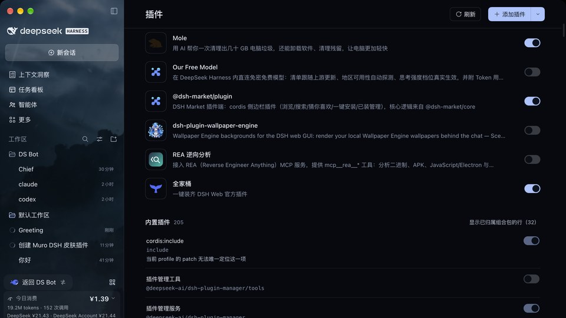

# Muro 影幕 · dsh-skin-muro

把 [Muro](https://github.com/MrRockySL/Muro)（macOS 原生动态壁纸 App）的 4K 壁纸搬进
[DeepSeek Harness](https://github.com/deepseek-ai/deepseek-harness) 的 Web GUI：全屏壁纸垫底、面板化为液态玻璃、
冰蓝 `#A9C4FF` 作为唯一强调色，并在设置里给出一整页壁纸管理。

中文 · [English](#english)



## 这是什么

一个 DSH 插件（同时是一个标准皮肤目录）：

- **皮肤** `skin/`：清单 v2 + 335 个 `--dsw-*` token 的亮/暗映射 + L3 补丁 + 预览图
- **插件** `src/`：设置里的「Muro 影幕」分区 —— 壁纸目录、下载、进度、分类、设为暗/亮壁纸、壁纸调节、下载位置

壁纸来自 Muro 的公开目录 `cdn.murowallpaper.com/catalog.json`（当前 551 张，7 个分类），
选中后本机下载 4K 母带、用 AVFoundation 定格一帧、缩到 2560×1440 存进本地库。**不需要安装 Muro App**。

## 功能

- **壁纸库**：进设置页自动加载 Muro 目录，支持标题搜索、分类筛选、`全部 / 本地` 切换
- **下载**：每张未下载的卡片一个「下载资源」按钮，卡内显示真实字节进度；完成后打「本地」角标
- **设为壁纸**：本地卡片上两个按钮「设为暗色壁纸 / 设为亮色壁纸」，秒级本地拷贝，随后自动应用并刷新
- **壁纸调节**：压暗 / 面板 / 模糊 / 亮度 / 饱和 / 对比 / 灰度 / 取景，另有 `柔和 / 标准 / 强反差` 预设
  - 压暗默认**自动**：抽帧时量出这张图的平均亮度（luma 0–255），暗图少压、亮图多压
- **下载位置**：面板里显示本地库路径与占用，可「在访达中打开」或改到任意目录（旧壁纸会一起搬过去）
- **外观自持**：不依赖皮肤中心，自己注入样式与壁纸层，开关即生效

## 环境要求

- macOS（抽帧走 AVFoundation）
- DeepSeek Harness 桌面版（0.2.2-rc 系列验证）
- `swift`（Xcode Command Line Tools 自带即可）

## 安装

```sh
git clone <repo> dsh-skin-muro && cd dsh-skin-muro
```

桌面版的 profile 由 Electron 独占，`dsh plugin` 会拒绝，所以用等价的两步：

```sh
cd ~/.dsh/profiles/desktop
pnpm add "link:/绝对路径/dsh-skin-muro"
# 然后把 "dsh-skin-muro" 加进 package.json 的 dsh.profile.bundles
```

宿主插件热挂载：登记后重载页面（⌘R）即生效，设置左栏最下面出现「Muro 影幕」。

### 只要皮肤

```sh
cp -R skin ~/.dsh/skins/muro
```

> 注意：本机这一版 DSH（0.2.2-rc.3）里**皮肤中心不应用用户目录皮肤**（内置皮肤正常，`~/.dsh/skins/*` 一律无效）。
> 所以推荐直接装插件，外观由插件自己画。

## 使用

1. 打开 **设置 → Muro 影幕**，壁纸目录自动加载
2. 点卡片 = 选中；点「下载资源」= 下载这一张（有进度条）
3. 下载完出现「设为暗色壁纸 / 设为亮色壁纸」，点完立即生效
4. 不满意就到「壁纸调节」里拖压暗/面板，或点预设

## 设置项

| 项 | 范围 | 默认 | 作用 |
| --- | --- | --- | --- |
| 压暗 | 0–80% | 自动 | 壁纸与内容之间的遮罩，最直接的反差手段 |
| 面板 | 0–85% | 45% | 面板不透明度：越高越压住壁纸、文字越好读 |
| 模糊 | 0–24px | 0 | 柔化壁纸细节 |
| 亮度 / 饱和 / 对比 | 50–130% / 0–160% / 80–140% | 100 / 105 / 100 | 壁纸本身 |
| 灰度 | 0–100% | 0 | 去色 |
| 取景 | 居中 / 上 / 下 | 居中 | 竖向裁切位置 |

设置写在 `~/.dsh/muro-appearance.json`，壁纸库路径写在 `~/.dsh/muro-config.json`。

## 工作原理

```
页面（src/client.js）                      宿主（src/index.js）
  │ GET  /muro/state                          → 安装状态、当前底图、本地库、外观设置
  │ GET  /muro/catalog?q=&category=&local=    → Muro 目录（10 分钟缓存）
  │ POST /muro/download {id}                  → 后台作业：下载母带（3 次重试）→ 抽帧 → 入本地库
  │ GET  /muro/job?id=                        ←  { stage, received, total }
  │ POST /muro/apply {id, theme}              → 拷贝成 backdrop-<theme>-<stamp>.jpg 并改写 skin.json
  │ POST /muro/appearance / /muro/cache       → 外观开关、调节值、下载位置
  └ 注入 <link href="/muro/skin.css?v=…"> 并设 html[data-muro-skin]
```

四个不显然的决定：

1. **外观自持**：皮肤中心在本版不认用户目录皮肤，插件因此自己把 `skin/skin.css` 的 `:root` 重写成
   `html[data-muro-skin]`，`patches.css` 每条选择器加同一前缀后一起发出。
2. **分层顺序**：壁纸 `body::before` 用 `z-index:0`、压暗层 `z-index:1`、`body>*` 抬到 `z-index:2`。
   负 z-index 会掉到所有不透明祖先后面——中栏铺底时壁纸就整块被盖住（这个坑踩过）。
3. **每次换图换文件名**：同名文件会被浏览器图片缓存吃掉，所以写 `backdrop-<theme>-<stamp>.jpg` 并改写清单。
4. **样式热更新**：宿主在 `/muro/state` 里报 `styleStamp`（css 的 mtime），页面每 4 秒对一次，改样式无需刷新。

## 排障

- **皮肤突然消失、插件列表显示「未运行 / cannot resolve profile bundle」**
  插件目录被移动或改名了。profile 记的是绝对路径，重新指一次即可：
  ```sh
  cd ~/.dsh/profiles/desktop && pnpm add "link:<新路径>"
  ```
  再在插件管理里关一下开一下（或重启 DSH）。
- **中栏纯黑 / 皮肤只有侧栏生效**：两个已知原因——
  1) 壁纸层的 z-index 与中栏的不透明底色：AppFrame 的 .centerCol、ConversationRoot 的 .root 都用
     --dsw-alias-bg-base 铺底；本插件用 L3 补丁把这两处清成透明。
  2) token 声明的位置：外壳把暗色 token 声明在 body[data-ds-dark-theme] 上，而继承来的值永远赢不了
     被继承元素上直接声明的值。所以本插件把整套 token 映射输出到 html[data-muro-skin] body
     （暗色再加 [data-muro-theme="dark"]）——这是皮肤能否上色的关键。
- **右侧中栏是黑的、只有侧栏有壁纸**：壁纸层必须是 `z-index:0` 且内容抬到 2，见上文第 2 点；
  若被旧版本缓存，按一次 ⌘R。
- **皮肤中心里点「Muro 影幕」没反应**：本版 DSH 的用户目录皮肤通道失效，属上游问题；插件不依赖它。
- **下载失败**：目录与母带都来自 Muro 的 CDN，失败时页面顶部红字会写明阶段；换一张或稍后再试，
  失败不会留下半个文件。

## 许可与致谢

- 代码与 `skin/assets/` 里的默认底图：MIT（`tools/make-default-backdrops.py` 生成，仓库不含第三方素材）
- 通过界面下载的 Muro 壁纸：版权归各自作者，Muro 的
  [NOTICE.md](https://github.com/MrRockySL/Muro/blob/main/NOTICE.md) 明确其不可再分发，只存在你自己机器上
- 感谢 [Muro](https://github.com/MrRockySL/Muro)（壁纸库与视觉语言）与
  [dsh-skins / 皮肤中心](https://github.com/zhu1090093659/dsh-skins)（皮肤清单 v2 契约）

## English

**dsh-skin-muro** brings Muro’s 4K live-wallpaper stills to the DeepSeek Harness web GUI: a full-bleed
wallpaper under liquid-glass panels, ice blue `#A9C4FF` as the only accent, and a settings section that
manages the library.

### Features

- Browses `cdn.murowallpaper.com/catalog.json` (551 wallpapers, 7 categories); no Muro app required
- One **下载资源** action per wallpaper, with real byte progress; finished entries are marked 本地
- 设为暗色壁纸 / 设为亮色壁纸 copies the local frame, repoints the skin manifest and applies instantly
- Wallpaper dials: dim (auto, derived from each frame’s mean luma), panel opacity, blur, brightness,
  saturation, contrast, grayscale, framing, plus 柔和 / 标准 / 强反差 presets
- Configurable download folder (shown in the panel, opens in Finder, migrates the library on change)

### Install (macOS + DSH desktop)

```sh
git clone <repo> dsh-skin-muro
cd ~/.dsh/profiles/desktop
pnpm add "link:/absolute/path/to/dsh-skin-muro"
# add "dsh-skin-muro" to dsh.profile.bundles in package.json, then reload the page
```

Requires `swift` (Xcode Command Line Tools) for frame extraction. The plugin paints its own stylesheet,
so it does not depend on the skin-center applying user skins.

### Notes

- Moving the plugin folder breaks the absolute `link:` — re-run `pnpm add "link:<new path>"`.
- Downloaded wallpapers belong to their original authors (see Muro’s NOTICE.md) and stay on your machine.

### Topics for GitHub

`dsh-plugin` · `dsh-skin` · `deepseek-harness` · `wallpaper` · `macos` · `cordis-plugin`
