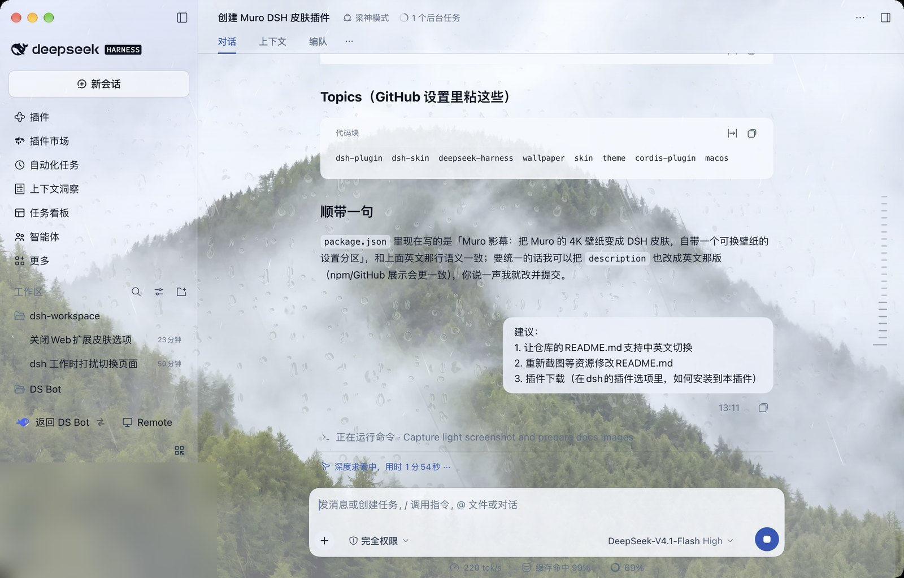

# Muro 影幕 · dsh-skin-muro

**中文** · [English](README.en.md)

把 [Muro](https://github.com/MrRockySL/Muro)（macOS 原生动态壁纸 App）的 4K 壁纸搬进
[DeepSeek Harness](https://github.com/deepseek-ai/deepseek-harness) 的 Web GUI：全屏壁纸垫底、面板化为液态玻璃、
冰蓝 `#A9C4FF` 作为唯一强调色，并在设置里给出一整页壁纸管理。

| 浅色 | 暗色 |
| --- | --- |
|  |  |

## 功能

- **壁纸库**：进设置页自动加载 Muro 的公开目录（551 张 / 7 个分类），标题搜索、分类筛选、`全部 / 本地` 切换
- **下载**：每张未下载的卡片一个「下载资源」，卡内显示真实字节进度；完成后打「本地」角标
- **设为壁纸**：本地卡片上有「设为暗色壁纸 / 设为亮色壁纸」，秒级本地拷贝，随后自动应用
- **跟随系统亮暗**：壁纸随 macOS 外观（或 DSH 主题）切换；某一侧没设过壁纸时回退另一侧，不会空白
- **壁纸调节**：压暗 / 面板 / 模糊 / 亮度 / 饱和 / 对比 / 灰度 / 取景，另有「柔和 / 标准 / 强反差」预设；压暗默认按每张图的平均亮度（luma）自动取值
- **下载位置**：面板里显示本地库路径与占用，可在访达中打开，或改到任意目录（旧壁纸会一起搬过去）
- **外观自持**：不依赖皮肤中心，插件自己注入样式与壁纸层

## 环境要求

- macOS（抽帧走 AVFoundation）
- DeepSeek Harness 桌面版（0.2.2-rc 系列验证）
- `swift`（Xcode Command Line Tools 自带即可）

## 安装

### 方式一：命令行（推荐，已验证可用）

```sh
git clone <repo> dsh-skin-muro
cd ~/.dsh/profiles/desktop
pnpm add "link:/绝对路径/dsh-skin-muro"
```

然后编辑 `~/.dsh/profiles/desktop/package.json`，把 `"dsh-skin-muro"` 加进 `dsh.profile.bundles` 数组，
重载页面（或重启 DSH）后，设置左栏最下面出现 **Muro 影幕**。

### 方式二：DSH 侧边栏的「插件」页

DSH 的插件面板（侧边栏 → 插件 / 插件市场）按 npm 规格解析。**本插件没有发布到 npm，所以不能按包名安装**；
如果你的版本接受本地路径，可以直接填：

```
link:/绝对路径/dsh-skin-muro
```

不接受就回到方式一。装好之后：**侧边栏插件页**能启停它、看它占用哪一行；**设置页里的插件列表是只读的**（官方设计如此）。

### 方式三：从 npm 装（已发布，最省事）

`dsh-skin-muro` 已在 npm 上，插件面板直接填包名即可；或用命令行：

```sh
cd ~/.dsh/profiles/desktop
pnpm add dsh-skin-muro
```

再把 `"dsh-skin-muro"` 加进 `dsh.profile.bundles`。

发新版（维护者）：

```sh
npm version patch && git push --follow-tags   # tag 触发 GitHub Actions，带 provenance 发布
```

### 只要皮肤（不装插件）

```sh
cp -R skin ~/.dsh/skins/muro
```

> 注意：本机这一版 DSH（0.2.2-rc.3）里**皮肤中心不应用用户目录皮肤**（内置皮肤正常，`~/.dsh/skins/*` 一律无效）。
> 所以推荐装插件，外观由插件自己画。

## 使用

1. 打开 **设置 → Muro 影幕**，壁纸目录自动加载
2. 点卡片 = 选中；点「下载资源」下载这一张（有进度条）
3. 下载完点「设为暗色壁纸 / 设为亮色壁纸」，立即生效
4. 对比不满意 → 「壁纸调节」里拖压暗/面板，或点预设；拖动实时生效，不需要刷新

## 设置项

| 项 | 范围 | 默认 | 作用 |
| --- | --- | --- | --- |
| 压暗 | 0–80% | 自动 | 壁纸与内容之间的遮罩，最直接的反差手段 |
| 面板 | 0–85% | 45% | 面板不透明度：越高越压住壁纸、文字越好读 |
| 模糊 | 0–24px | 0 | 柔化壁纸细节 |
| 亮度 / 饱和 / 对比 | 50–130% / 0–160% / 80–140% | 100 / 105 / 100 | 壁纸本身 |
| 灰度 | 0–100% | 0 | 去色 |
| 取景 | 居中 / 上 / 下 | 居中 | 竖向裁切位置 |

设置写在 `~/.dsh/muro-appearance.json`，壁纸库路径写在 `~/.dsh/muro-config.json`。

## 工作原理

```
页面（src/client.js）                      宿主（src/index.js）
  │ GET  /muro/state                          → 安装状态、两侧底图、本地库、外观设置
  │ GET  /muro/catalog?q=&category=&local=    → Muro 目录（10 分钟缓存）
  │ POST /muro/download {id}                  → 后台作业：下载母带（3 次重试）→ 抽帧 → 入本地库
  │ GET  /muro/job?id=                        ←  { stage, received, total }
  │ POST /muro/apply {id, theme}              → 拷贝成 backdrop-<theme>-<stamp>.jpg 并改写 skin.json
  │ POST /muro/appearance / /muro/cache       → 外观开关、调节值、下载位置
  └ 注入 <link href="/muro/skin.css?v=…"> 并设 html[data-muro-skin]
```

五个不显然的决定：

1. **外观自持**：皮肤中心在本版不认用户目录皮肤，插件自己把 `skin/skin.css` 的 `:root` 重写成 `html[data-muro-skin]`，`patches.css` 每条选择器加同一前缀后一起发出。
2. **token 落在 body 上**：外壳把暗色 token 声明在 `body[data-ds-dark-theme]`，继承来的值赢不了它，所以整套映射输出到 `html[data-muro-skin] body`。
3. **壁纸层用负 z-index**，外壳的中栏/侧栏底色由补丁清成透明；把 body 子元素抬到正值会破坏外壳浮层。
4. **每次换图换文件名**：同名文件会被浏览器图片缓存吃掉。
5. **主题切换交给 CSS 媒体查询**：默认亮色规则 + `@media (prefers-color-scheme: dark)` 覆盖，两个方向都即时；只有外壳显式选了亮/暗（与系统不一致）时才写 `data-muro-theme` 覆盖。

## 国内镜像（npmmirror）

如果 pnpm 走的是 `registry.npmmirror.com`，刚发布的版本可能报 `No matching version found for dsh-skin-muro@x.y.z`：
镜像的**索引**还没同步（tarball 往往已经能取到，`/dsh-skin-muro/<version>` 返回 200，但 index 里的 versions 仍是旧的）。
三种绕法：

```sh
pnpm add dsh-skin-muro --registry=https://registry.npmjs.org   # 这一次走官方源
curl -X PUT "https://registry.npmmirror.com/-/package/dsh-skin-muro/syncs?sync_upstream=true"  # 触发镜像同步
# 或者本地开发直接用 link:
pnpm add "link:/绝对路径/dsh-skin-muro"
```

## 排障

- **皮肤突然消失、插件列表显示「未运行 / cannot resolve profile bundle」**：插件目录被移动或改名了。profile 记的是绝对路径，重新指一次即可：`cd ~/.dsh/profiles/desktop && pnpm add "link:<新路径>"`，再在插件页关一下开一下（或重启 DSH）。
- **中栏纯黑 / 皮肤只有侧栏生效**：见上文第 2、3 条（token 位置、负 z-index）。
- **设置里没有「Muro 影幕」**：客户端模块的 `window.__ModuleLoader__.load({ id })` 必须等于包名；改名后要同步，模块被丢弃时不会报错。
- **皮肤中心里点「Muro 影幕」没反应**：本版 DSH 的用户目录皮肤通道失效，属上游问题；插件不依赖它。
- **下载失败**：目录与母带都来自 Muro 的 CDN，失败时页面顶部红字会写明阶段；换一张或稍后再试。

## 许可与致谢

- 代码与 `skin/assets/` 里的默认底图：MIT（`tools/make-default-backdrops.py` 生成，仓库不含第三方素材）
- 通过界面下载的 Muro 壁纸：版权归各自作者，Muro 的 [NOTICE.md](https://github.com/MrRockySL/Muro/blob/main/NOTICE.md) 明确其不可再分发，只存在你自己机器上
- 感谢 [Muro](https://github.com/MrRockySL/Muro)（壁纸库与视觉语言）与 [dsh-skins / 皮肤中心](https://github.com/zhu1090093659/dsh-skins)（皮肤清单 v2 契约）